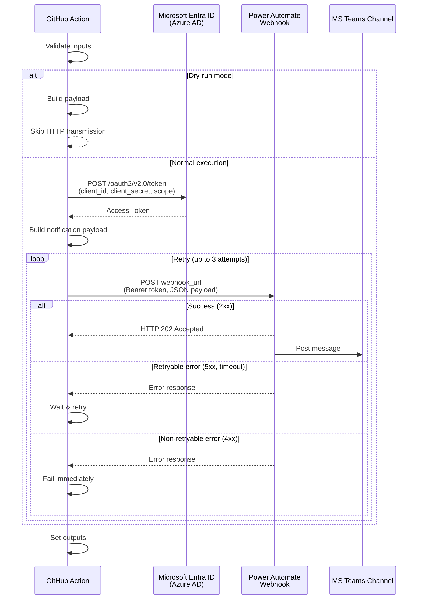

# MS Teams Webhook Notification Action

A GitHub Action that sends customizable notifications to a secure MS Teams webhook using OAuth2 client credentials authentication.



## Prerequisites

1. **Azure AD App Registration** with:
   - Client ID
   - Client Secret  
   - Tenant ID
   - API permission: `https://service.flow.microsoft.com//.default`

2. **Power Automate Webhook** configured to:
   - Accept HTTP POST requests
   - Require Azure AD authentication
   - Post to your Teams channel

3. **GitHub Repository Secrets**:
   - `TEAMS_CLIENT_ID`
   - `TEAMS_CLIENT_SECRET`
   - `TEAMS_TENANT_ID`
   - `TEAMS_WEBHOOK_URL`

## Quick Start

### Basic Usage with Convenience Parameters

```yaml
name: Notify Teams

on:
  push:
    branches: [main]

permissions:
  contents: read

jobs:
  notify:
    runs-on: ubuntu-latest
    steps:
      - name: Send Teams Notification
        uses: s4heid/ms-teams-webhook-action@v1
        with:
          client_id: ${{ secrets.TEAMS_CLIENT_ID }}
          client_secret: ${{ secrets.TEAMS_CLIENT_SECRET }}
          tenant_id: ${{ secrets.TEAMS_TENANT_ID }}
          webhook_url: ${{ secrets.TEAMS_WEBHOOK_URL }}
          status: success
          title: 'Build Complete'
          summary: 'Commit ${{ github.sha }} by ${{ github.actor }}'
          repository: ${{ github.repository }}
          run_url: ${{ github.server_url }}/${{ github.repository }}/actions/runs/${{ github.run_id }}
```

### Custom JSON Body

```yaml
- name: Send Custom Message
  uses: s4heid/ms-teams-webhook-action@v1
  with:
    client_id: ${{ secrets.TEAMS_CLIENT_ID }}
    client_secret: ${{ secrets.TEAMS_CLIENT_SECRET }}
    tenant_id: ${{ secrets.TEAMS_TENANT_ID }}
    webhook_url: ${{ secrets.TEAMS_WEBHOOK_URL }}
    body: '{"message": "Build completed for ${{ github.repository }}"}'
```

## Inputs

| Input | Required | Default | Description |
|-------|----------|---------|-------------|
| `client_id` | ✔️ | - | Azure AD application client ID |
| `client_secret` | ✔️ | - | Azure AD application client secret |
| `tenant_id` | ✔️ | - | Azure AD tenant ID |
| `webhook_url` | ✔️ | - | Power Automate webhook URL (HTTPS only) |
| `body` | ✖️ | - | JSON message body (simple message or Adaptive Card) |
| `status` | ✖️ | - | Build status: `success`, `failure`, or `cancelled` |
| `title` | ✖️ | - | Notification title |
| `summary` | ✖️ | - | Summary text or error description |
| `repository` | ✖️ | - | Repository name (owner/repo format) |
| `run_url` | ✖️ | - | URL to the workflow run |
| `dry_run` | ✖️ | `false` | Validate without sending (for PRs) |
| `fail_on_error` | ✖️ | `false` | Fail workflow if notification fails |
| `timeout` | ✖️ | `10000` | Request timeout in milliseconds (max 30000) |

## Outputs

| Output | Description |
|--------|-------------|
| `notification_sent` | `true` if notification was sent successfully |
| `response_code` | HTTP status code from webhook response |
| `retry_count` | Number of retry attempts (0-3) |
| `duration_ms` | Total execution time in milliseconds |
| `error_message` | Error message if notification failed |
| `skip_reason` | Reason if skipped: `dry_run` or `duplicate` |

## Advanced Usage

### Dry-Run Mode for Pull Requests

```yaml
name: PR Validation

on:
  pull_request:

jobs:
  validate:
    runs-on: ubuntu-latest
    steps:
      - name: Validate Notification Config
        uses: s4heid/ms-teams-webhook-action@v1
        with:
          client_id: ${{ secrets.TEAMS_CLIENT_ID }}
          client_secret: ${{ secrets.TEAMS_CLIENT_SECRET }}
          tenant_id: ${{ secrets.TEAMS_TENANT_ID }}
          webhook_url: ${{ secrets.TEAMS_WEBHOOK_URL }}
          status: success
          title: 'PR Validation'
          dry_run: true
```

### Using Action Outputs

```yaml
- name: Send Notification
  id: notify
  uses: s4heid/ms-teams-webhook-action@v1
  with:
    # ... inputs ...

- name: Check Result
  run: |
    echo "Sent: ${{ steps.notify.outputs.notification_sent }}"
    echo "Response: ${{ steps.notify.outputs.response_code }}"
    echo "Retries: ${{ steps.notify.outputs.retry_count }}"
    echo "Duration: ${{ steps.notify.outputs.duration_ms }}ms"
```

### Custom Adaptive Card

```yaml
- name: Send Adaptive Card
  uses: s4heid/ms-teams-webhook-action@v1
  with:
    client_id: ${{ secrets.TEAMS_CLIENT_ID }}
    client_secret: ${{ secrets.TEAMS_CLIENT_SECRET }}
    tenant_id: ${{ secrets.TEAMS_TENANT_ID }}
    webhook_url: ${{ secrets.TEAMS_WEBHOOK_URL }}
    body: |
      {
        "$schema": "http://adaptivecards.io/schemas/adaptive-card.json",
        "type": "AdaptiveCard",
        "version": "1.5",
        "body": [
          {
            "type": "TextBlock",
            "text": "🚀 Deployment Complete",
            "weight": "Bolder",
            "size": "Large"
          },
          {
            "type": "FactSet",
            "facts": [
              { "title": "Environment", "value": "Production" },
              { "title": "Version", "value": "${{ github.ref_name }}" }
            ]
          }
        ]
      }
```

## Development

```bash
# Install dependencies
npm install

# Run tests
npm test

# Build for distribution
npm run build

# Lint
npm run lint
```

## License

[MIT](./LICENSE)
